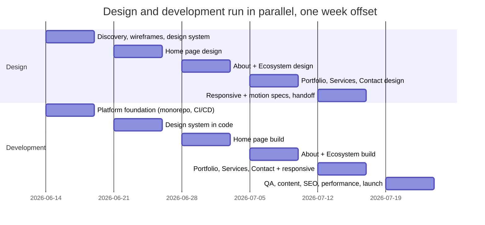

# Timeline & Milestones

This page tracks the department's **delivery commitments** — what we have
promised, by when, and how progress stays verifiable week by week.

<Callout type="important">
  **This page is owed a retrospective.** The commitment below ran to 23 July
  2026 and the dates have passed; `apps/group` is built and redeploys to its
  Vercel project on every merge to `main`. What is not recorded anywhere is the
  *outcome*: what shipped on the date, what slipped, and what the six-week
  estimate turned out to be worth.

  That last number matters beyond one website — the whole monorepo argument
  rests on "six weeks becomes one week per site as the packages mature"
  ([ADR-001](/architecture/adrs)), and the first real data point on it is this
  project. Someone who was there has to write it; this handbook will not guess
  it.

  One outcome is on record: on **21 September 2026** adawygroup.com moved from
  the old WordPress host to `apps/group` on Vercel, with adawystudio.com,
  adawypack.com, adawyprint.com, adawysupplies.com and
  adawymarketingsolutions.com moving on the same day
  ([how](/guides/move-a-domain-to-vercel)).
</Callout>

## The commitment: the Adawy Group website

The first app on the unified platform is the new **adawygroup.com** — the
portfolio site presenting the group, its story, its business units, and its
work. Six weeks from kickoff to launch, with design and development running in
parallel (development stays ~one week behind design at all times).

**Kickoff: Sunday 14 June 2026 → Launch target: Thursday 23 July 2026.**
If kickoff moves, every date shifts by the same amount.

| Date | Milestone | What leadership can verify |
| ---- | --------- | -------------------------- |
| Thu 18 Jun | Design direction approved, staging live | Visual direction in Figma + a working staging link |
| Thu 25 Jun | Design system approved and built in code | Brand colors, typography, components rendered in the browser |
| Thu 2 Jul | Home page live on staging | The first complete piece of the site — also the **content deadline** |
| Thu 9 Jul | Majority of the site reviewable | Home, About, Ecosystem clickable on staging |
| Thu 16 Jul | Design 100% handed off, all pages built (v1) | Every page exists on staging; the last week is refinement only |
| **Thu 23 Jul** | **Launch** | The new site live on the production domain |

Three external dependencies protect these dates: **content delivered by 2
July**, **approvals within two working days** of each milestone review, and a
**frozen scope** (new ideas go to the backlog, scheduled after launch). The
working week is Sunday–Thursday.

**Why this matters beyond one website:** the foundation built in week one —
the monorepo and its shared packages, hosting, domains, deployment pipeline — is
permanent infrastructure. Every Adawy site that follows runs on it, which is
why later sites ship in weeks, then days, instead of months.

## Since the websites moved

Dated milestones after the six domains moved, newest last. Each is something
you can open and check, not a status claim.

| Date | Milestone | Where to check |
| ---- | --------- | -------------- |
| Mon 21 Sep 2026 | adawygroup.com and five brand domains move their websites to Vercel; DNS and email stay on the Verpex host | [Domains, DNS & Email](/architecture/domains-and-email), [ADR-013](/architecture/adrs) |
| Wed 23 Sep 2026 | adawybusinessdevelopment.com goes live on Vercel — the seventh domain, and the first with DNS on Cloudflare | The domain; [its row](/architecture/domains-and-email#the-domains) |
| Wed 23 Sep 2026 | The organisation's free GitHub Actions minutes run out; every workflow fails within seconds and production deploys become manual | [Deployment](/how-we-work/deployment#most-workflows-run-only-by-hand) |
| Wed 23 Sep 2026 | The Aladawy Shop WordPress rebuild reaches its password-protected staging site, with cash on delivery and customer accounts added the same day | [`aladawy-shop-wp`](/repositories/aladawy-shop-wp) |
| Thu 24 Sep 2026 | The rebuilt Aladawy Shop goes live on aladawyshop.com | The domain; [ADR-015](/architecture/adrs) |
| Sat 26 Sep 2026 | Aladawy Pack's website moves to WordPress on aladawypack.com, on the department's own `aladawy-pack` theme | The domain; [Our Systems](/architecture/systems#the-client-sites-that-stay-on-wordpress) |
| Sun 27 Sep 2026 | The content dashboard goes online at `admin.adawygroup.com` for the team to practise on, publishing to a practice repository | [`adawy-dashboard`](/repositories/adawy-dashboard), [ADR-014](/architecture/adrs) |
| Sun 27 Sep 2026 | The captioned training videos for the dashboard and both Aladawy sites are complete | [Training Videos](/guides/training-videos) |
| Sun 27 Sep 2026 | Every workflow in the org is switched to run only when started by hand, so nothing spends Actions minutes unasked | [Deployment](/how-we-work/deployment#most-workflows-run-only-by-hand) |
| Sun 27–Tue 29 Sep 2026 | Every site names Adawy Software as its publisher, the client sites gain a footer credit, and every site sends an `X-Robots-Tag` header | [Client Projects](/how-we-work/client-projects#the-go-live-switch) |
| Tue 29 Sep 2026 | **Zad Al-Hkoul goes live and indexable on zadalhkoul.com** — the first client site launched through the environment-variable switch | The domain; [`zad-alhkoul`](/repositories/zad-alhkoul) |
| Tue 29 Sep 2026 | Twenty-four holding apps for the newer Adawy brands join the platform, taking it to thirty-one apps; the old Aladawy Shop build on Vercel drops out of search | [`adawy-platform`](/repositories/adawy-platform) |
| Thu 1 Oct 2026 | adawygroup.com grows from six to thirteen company pages, each with its own 3D scene; the Actions minutes reset | [Platform Architecture](/architecture/platform-architecture) |
| Fri 2 Oct 2026 | The Aladawy Pack theme enters git as `aladawy-pack-wp`, verified identical to the live files; the Aladawy Shop rebuild is merged into `main` | [`aladawy-pack-wp`](/repositories/aladawy-pack-wp), [`aladawy-shop-wp`](/repositories/aladawy-shop-wp) |
| Sat 3 Oct 2026 | `adawy-platform` deploys on merge and previews pull requests again, verifying only what a change reaches; every other repo stays hand-only | [Deployment](/how-we-work/deployment#most-workflows-run-only-by-hand) |
| Tue 6 Oct 2026 | The adawygroup.com home entrance is rebuilt as one shot over the Adawy pattern, counting through the years from 1971 | [Platform Architecture](/architecture/platform-architecture) |
| Sun 11 Oct 2026 | The ICOFFEE store's new Shopify theme, its accounts and checkout app and its scripts enter git as `icoffee`, a week after the work began; the new design is built and not yet published | [`icoffee`](/repositories/icoffee), [ADR-016](/architecture/adrs) |
| Sun 11 Oct 2026 | adawygroup.com gets a careers page in three languages, with an applicant's badge and a form that fills itself in from the uploaded CV | [`adawy-platform`](/repositories/adawy-platform) |
| Sun 11 Oct 2026 | Aladawy Shop gets its own link-in-bio page, Arabic first with the brand red leading | [`aladawy-shop-links`](/repositories/aladawy-shop-links) |
| Mon 12 Oct 2026 | The Meta Pixel goes on every adawygroup.com page for the hiring campaign, with Meta's hosts allowed in the content-security policy; the Actions minutes run out again | [`adawy-platform`](/repositories/adawy-platform), [Deployment](/how-we-work/deployment#most-workflows-run-only-by-hand) |
| Tue 13 Oct 2026 | **Jumeira Catering goes live on jumeiracatering.com**; Search Console verifies it and takes the sitemap on 19 October | The domain; [`jumeira`](/repositories/jumeira) |
| Tue 20 Oct 2026 | **The ICOFFEE store goes live on icoffeeegypt.com** on the new theme, with the department's own points programme | The domain; [`icoffee`](/repositories/icoffee) |
| Wed 21 Oct 2026 | ICOFFEE's client sets the points rate (1000 points = 25 EGP), and order emails start following the language the shopper checked out in | [`icoffee`](/repositories/icoffee) |
| Thu 22 Oct 2026 | The Adawy Software site becomes the "Inside Adawy Software" scroll film, with adawysoftware.com named as its production host (the domain itself still waits on its DNS) | [`adawy-platform`](/repositories/adawy-platform) |
| Tue 27 Oct 2026 | **The Aladawy Pack redesign goes live** on aladawypack.com, with a careers page whose applications are saved in wp-admin before they are emailed | The domain; [`aladawy-pack-wp`](/repositories/aladawy-pack-wp) |
| Tue 27 Oct 2026 | A domain audit finds 15 group domains not reaching their sites: 12 parked at name.com, 2 with a Cloudflare 525, 1 pointing at cPanel. Every site is up on its `vercel.app` address | [Domains, DNS & Email](/architecture/domains-and-email) |
| Tue 27–Wed 28 Oct 2026 | Adawy Studio's own site replaces its holding page on adawystudio.com | The domain; [`adawy-platform`](/repositories/adawy-platform) |
| Wed 28 Oct 2026 | The group site matches the 2026 company profile, and the Adawy Group links page opens the profile in the reader's language | [`adawy-group-links`](/repositories/adawy-group-links) |
| Tue 3 Nov 2026 | A security and dependency sweep lands as one pull request per repository, all merged, deployed and checked live the same day: Node 24, pnpm 12 and current Next.js everywhere, Dependabot alerts on in every repo | [Tech Stack](/architecture/tech-stack) |
| Sun 8 Nov 2026 | The 28 brand apps share one shell; the Actions minutes run out a fourth time, and platform deploys go by hand until December | [`adawy-platform`](/repositories/adawy-platform) |
| Mon 9–Tue 10 Nov 2026 | Adawy Studio v2: a 3D character on a dark stage, then About, Work, Services, Contact and Careers rebuilt around it | adawystudio.com; [`adawy-platform`](/repositories/adawy-platform) |
| Thu 19 Nov 2026 | A second dependency round merges and deploys everywhere; Dependabot now runs monthly and groups its updates, so a repo gets a few pull requests a month instead of one per package | Each repo's `.github/dependabot.yml` |

What comes next is on the
[roadmap](/architecture/roadmap#what-is-next-in-the-short-term).

For what comes after launch, see the [phased roadmap](/architecture/roadmap).
