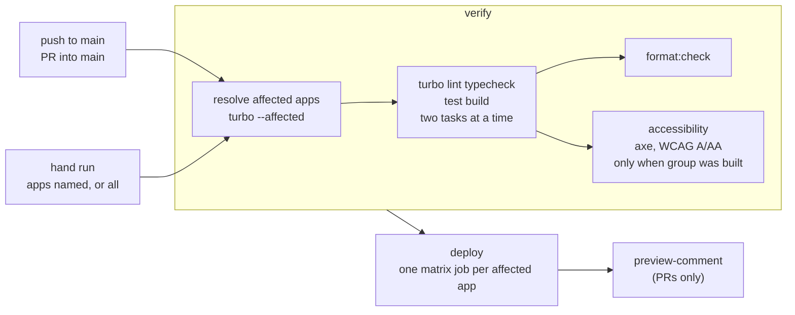

# `adawy-platform`

<Badge tone="group">Group</Badge>

**The brand-sites monorepo for Adawy Group.** A thin Next.js app per Adawy
brand, built from shared `@adawy/*` packages. `group` is the full site,
`studio` and `software` are those two companies' own sites, and the other
twenty-eight apps are holding pages: five for the original flagships, and
twenty-three of the twenty-four added on 2026-09-29 for the brands in the
designer's logo delivery (the twenty-fourth, `software`, has since become a
site). This is the department's largest and most active codebase, and the one
every Group standard is written about.

Private · Turborepo + pnpm 12.16.1 · Node 24 · TypeScript

<Stats>
  <Stat value="31" label="apps" hint="1 group site · 2 company sites · 28 holding pages" />
  <Stat value="10" label="shared packages" hint="@adawy/*" />
  <Stat value="3" label="platform locales" hint="en · ar · fr — group only serves fr" />
</Stats>

## What is in it today

```
apps/
├── group/      Adawy Group  → adawygroup.com  (the full site, en/ar/fr)
│   ├── app/         routes only: /, /about, /careers, /contact, /ecosystem, /ecosystem/[brand] (+ md/, og/)
│   ├── features/    one per thing a visitor can point at (hero, brands, careers, stage, …)
│   │                each is components/ + scene/ (three.js) + lib/ (pure)
│   └── platform/    app-wide machinery: chrome, scroll, gl, mail, perf, sound, seo, …
├── studio/     Adawy Studio                → adawystudio.com, a 3D stage: home, about, work,
│                                             services, contact, careers (en/ar)
├── software/   Adawy Software              → adawysoftware.com (parked; served on
│                                             its Vercel address), the desktop story (en/ar)
├── pack/       Adawy Pack                  → adawypack.com, holding page (en/ar)
├── print/      Adawy Print                 → adawyprint.com, holding page (en/ar)
├── supplies/   Adawy Supplies              → adawysupplies.com, holding page (en/ar)
├── marketing/  Adawy Marketing Solutions   → adawymarketingsolutions.com, holding page (en/ar)
├── bizdev/     Adawy Business Development  → adawybusinessdevelopment.com, holding page (en/ar)
└── it/ … manufacturer/                     23 glyph-brand holding pages, no domain yet (en/ar)

packages/
├── ui/                 @adawy/ui         shadcn primitives, the theme slots, the CSSProperties typing; ours to edit
├── motion/             @adawy/motion     GSAP (+ SplitText, ScrambleText) + Lenis, registered once; useInView
├── i18n/               @adawy/i18n       locale list, direction, next-intl helpers
├── site/               @adawy/site       identity, routes, hreflang, robots, sitemap, proxy, next-config helpers,
│                                         the group's JSON-LD and software credit, test helpers
├── brand-app/          @adawy/brand-app  the brand-app shell: layout, page, holding page, fonts, holding.css,
│                                         BrandMark, entrances, icon bake
├── analytics/          @adawy/analytics  PostHog behind a consent banner, for every app
├── gl/                 @adawy/gl         WebGL renderer create/dispose, resolution governor, DPR cap, meshopt, eases
├── mail/               @adawy/mail       Resend mailer, header-safe senders, HTML escaping, rate limit, mail env
├── eslint-config/      the architecture-enforcing lint rules
└── typescript-config/  shared tsconfig bases
```

The twenty-four glyph brands are `software`, `it`, `innovation`, `ai`,
`automation`, `financial`, `invest`, `law-firm`, `fnb`, `farm`, `shop`,
`fashion`, `recycle`, `security`, `hr`, `events`, `tv`, `advertising`,
`media-production`, `radio`, `production`, `plast`, `private-label` and
`manufacturer`. All but `software` are still holding pages.

**Identity is token values, not a forked component**, in every holding app,
so a brand's look cannot drift into a private copy of shared code. The two
generations of holding app differ in where those values come from and in how
much is bespoke:

| | The five flagship holding apps | The twenty-three glyph holding apps |
| --- | --- | --- |
| Field and ink | The pair measured in that brand's `[data-brand]` block in `apps/group/app/globals.css` | The brand's palette 300 as the field, and whichever of the group's two inks clears AA on it |
| Mark and entrance | Bespoke, animated per app; the copy and footer entrance is shared (`@adawy/brand-app/copy-entrance.css`) | The designer's glyph, drawn by `BrandMark`, with the shared bloom entrance (`@adawy/brand-app/entrance.css`) |
| Shell | `@adawy/brand-app` (since 2026-11-08, #394) | `@adawy/brand-app` |
| Contrast | Measured by hand and recorded in the app's `globals.css` | A test in `lib/brand/<app>-mark.test.ts` pins the pair at 4.5:1 |
| Domain | Each has one, and is indexed | None yet, so every deployment is `noindex` |

The shared entrance is CSS rather than GSAP because a JS timeline cannot
start until hydration, so a prerendered page would paint finished and then
jump back to the start. All thirty-one are real
apps with real Vercel deploys, which is why a change to `packages/ui` verifies
and deploys every one of them rather than one.

**A holding app is not a group brand page.** adawygroup.com has thirteen
company pages under `/ecosystem` (the six flagships plus Software, Private
Label, Production, Media Production, Events, AI and Law Firm). Seventeen of
the glyph brands have an app and no group page yet. The two lists are
maintained separately (`BRAND_PAGES` in the group app, the `apps/` folder and
the deploy map for the apps), so adding a brand to one does not add it to the
other.

**`studio` is a site of its own, rebuilt twice since it left the holding
page** (#300, 2026-09-22). The first version (from 2026-10-27, #365 to #385)
was a cream-and-orange page built from the studio's comps, with About, Work,
Services and Contact pages. The second (from 2026-11-05, #390 to #413) starts
over dark: a rigged 3D character in a VR headset on one stage, with the home
page's sections staged around her, About set inside the headset (the camera
dives through her visor), and Work, Services, Contact and Careers pages. The
Contact form takes an inquiry for several services and sends a branded mail to
the studio and a receipt to the visitor in the form's language; every form is
validated with zod on the server. On desktop, "look around with your head" is
opt-in and runs MediaPipe's face landmarker in a worker, so the camera image
never leaves the device. The 3D loads after the page (on first interaction or
idle), behind a quality ladder and a governor that steps down on slow devices,
because the headline has to paint at once on a phone. The studio's own
`PRODUCT.md` sits in `apps/studio`. The work is still data in
`apps/studio/lib/work/work.ts`, baked by `work:bake`.

**`software` is Adawy Software's own site.** It replaced its holding page on
2026-10-08 (#341). Since 2026-11-19 (#424, extended by #426) its front page is
a desktop story in `components/story/`: an office at night turns into a
software studio as the visitor scrolls (three.js), and the camera ends inside
a monitor where the page becomes a computer the visitor operates, with working
Figma, VS Code, GitHub, Deploy, Work, Team and Mail windows. Mail is a Server
Action that really emails the team (zod, a honeypot, a rate limit and BotID,
sent through `@adawy/mail`). The same company is also a plain server-rendered
page under the story, and a browser without JavaScript or a real GPU gets only
that, because PageSpeed renders without a GPU and a 3D room drawn on the CPU
freezes the main thread. Its `PRODUCTION_HOST` names adawysoftware.com, but
that domain is still parked at the registrar, so the site is served on its
Vercel address, which is `noindex` like any host that is not the production
one.

**`@adawy/brand-app` is the shell every holding app is built on.** It owns
everything around the holding page that each app used to copy: the `[locale]`
layout and metadata, the holding page itself, the fonts, `BrandMark`, the
shared entrances, `holding.css` (the imports, design slots and Arabic font
swap every brand stylesheet repeated), a WCAG contrast helper (`./contrast`)
and a Node-only `./icons` entry for the icon bake. A brand's `page.tsx` is one
`createHoldingPage({ routing, identity, mark, socials })` call, its
`proxy.ts` is `createBrandProxy(routing)` from `@adawy/site/proxy` plus the
matcher (which Next parses statically, so it cannot be imported), and its
`next.config.ts` is `createBrandNextConfig` from `@adawy/site/next-config`.
The package builds the locale-aware `Link` from the app's routing, so a
holding app has no `i18n/navigation.ts` and no holding component of its own.
`print` and the glyph brands came first (#281, 64f0333), `pack`, `supplies`,
`marketing` and `bizdev` moved on in the 2026-11-08 clean-up (#394), and the
2026-11-23 refactor (#430) folded the old `@adawy/holding` body into it.
`software` uses the shell's layout, `createBrandPage`, entrance and icon bake
around its own story. `apps/studio` uses only the icon bake and `BrandMark`
(through `@adawy/brand-app/brand-mark`, which skips the layout and its fonts,
with the petal entrance passed as `pieceClassName`), and `apps/group` none of
it, deliberately, because their routing, sitemap and layout all differ, so
**check an app's imports before assuming a change to the shell reaches it**.

The repo extracts a package on the **third use, not the first**, because an
abstraction made from one example encodes that example's accidents.
`@adawy/site` and the holding-page package came out once `pack` and `studio`
had hand-copied the same platform layer twice, and that is what made
twenty-four apps in one change affordable: each new app is mostly
configuration. `@adawy/mail` and `@adawy/gl` came out the same way on
2026-11-23 (#432), once `group`, `software` and `studio` each carried a fork of
the same mailer and WebGL renderer code, and the same refactor folded the
holding package into `@adawy/brand-app` and `@adawy/site` and the token
package into `@adawy/ui`, because neither had a job left of its own.
`@adawy/utils` is still waiting for a second caller. What `group` does not
share lives in its own `features/` + `platform/` layering
([ADR-011](/architecture/adrs)).

Planned but not built: `apps/sites` (the multi-tenant long tail,
[ADR-008](/architecture/adrs)) and `apps/api` (the Phase-2 NestJS backend,
[ADR-009](/architecture/adrs)).

## Stack

| | Version (Nov 2026) |
| --- | --- |
| Runtime | Node 24 (`engines: 24.x`) |
| Framework | Next.js 16.4.5, React 19.3.1, next-intl 4 |
| Language | TypeScript 7 (`tsc`) side by side with TypeScript 6, which typescript-eslint and Next still load as an API |
| Styling | Tailwind CSS 4.3, shadcn 4 on Base UI 1.9, Hugeicons |
| Motion & 3D | GSAP 3.15 + Lenis 1.3 (`@adawy/motion`), three.js 0.187, Rapier 0.21; `studio` adds matter-js and MediaPipe |
| Forms & email | react-hook-form 7 + zod 4, Resend 6, BotID |
| Analytics | posthog-js 1 behind a consent banner (`@adawy/analytics`); the Meta Pixel on the group site |
| Tooling | Turborepo 2.11, pnpm 12.16.1, ESLint 10 (flat config), Prettier 3, Vitest 5 |

`typescript` in every `package.json` is an alias to
`@typescript/typescript6`, and `@typescript/native` is TypeScript 7. That split
follows the TS 7.0 announcement: the fast compiler does the typechecking while
the tools that need the JS API keep working.

Because every app pins `next` and the rest in its own `package.json`, a
dependency bump touches all thirty-one files and the lockfile, and CI verifies
every app for it. Dependabot's grouped PRs therefore conflict with each other
once one merges, so the maintainer folds a round of bumps into one PR (#338,
#386) and CI verifies every app once instead of once per group.

## Commands

Everything runs from the repo root. **This repo is pnpm-only** — `npm install`
will produce a tree the lockfile does not describe. pnpm reads its settings
from `pnpm-workspace.yaml` (there is no `.npmrc`), so hoisting, build-script
allowances and security overrides all live there.

```bash
pnpm install
pnpm turbo dev --filter=group    # http://localhost:3000 → redirects to /en

# what CI gates on
pnpm turbo lint typecheck test build
pnpm format:check
pnpm --filter group a11y:check   # needs a running `pnpm --filter group start`
```

`--filter=group` scopes a task to one app. Each workspace is named after its
folder under `apps/` (`group`, `studio`, `pack`, `law-firm`,
`media-production`, …), plus the `@adawy/*` packages. A full
`pnpm turbo build` builds thirty-one Next.js apps; on a laptop, filter to the
apps you touched and let `--affected` or CI cover the rest.

Running a single test means working inside the app:

```bash
pnpm --filter=group exec vitest run messages/parity.test.ts
pnpm --filter=group exec vitest run -t "message parity"
pnpm --filter=group exec vitest                          # watch mode
```

`apps/group` also carries about twenty-five hand-run asset scripts
(`patterns:bake`, `blender:bake`, `polyhaven:fetch`, `models:recolor`,
`software:work`, …) that regenerate the committed 3D models, textures,
recordings and audio. Every other app has `icons:bake`, which writes the app
icons, `favicon.ico` and the Open Graph card from the brand's artwork
(`studio` also has `work:bake`, and `software` has `work:sync`).
Secrets for the group's forms (`RESEND_API_KEY`, `INQUIRY_TO`, `INQUIRY_FROM`)
are listed in `apps/group/.env.example`, and the software chat's (`CHAT_TO`,
`CHAT_FROM`) in `apps/software/.env.example`. `studio` has no example file:
`apps/studio/lib/env/env.ts` reads the Resend key, `INQUIRY_TO`,
`INQUIRY_FROM` and `RESEND_SEGMENT_ID` (the newsletter). All three apps parse
them with `parseMailEnv` from `@adawy/mail`, so a malformed value fails the
build the same way everywhere and a blank one counts as unset. A new build-time
secret also goes into the build task's `env` list in `turbo.json`, because
Turborepo hashes only the variables listed there and would otherwise reuse a
cached build after the value changed.

<Callout type="important">
  `pnpm format:check` is a **separate CI gate** from `turbo lint`. The
  per-package lint scripts only reach `.ts`/`.tsx`; README and CSS files drift
  too, so Prettier runs at the root. A green `turbo lint` does not mean CI will
  pass.
</Callout>

## Tests

Vitest, colocated, run with no config file. There are about 270 test files, and
about 180 of them sit in `apps/group`. They test the pure `lib/` layer (scroll
curves, physics, camera fits, each brand scene's choreography, the inquiry and
application schemas, CV reading, rate limit and email) because `lib/` holds no React or three.js and
runs without a DOM. Every app runs a **message parity** test from
`@adawy/site/testing`, which checks there is exactly one message file per
locale the app serves, and that every other locale has exactly the default
locale's keys. A missing key would otherwise fail only at render time in
production, because next-intl does not check keys at build time. Every glyph
brand also tests its mark: ink on field at 4.5:1 or better, and no duplicate
piece, since each piece's path is its React key.
`group` adds `brand-spelling` and `seo` checks on its messages. `software`
tests its chat, work list and structured data, and `studio` its inquiry,
application and newsletter. The packages test locales and direction (`i18n`),
identity, routes, robots, alternates, the proxy, the organisation structured
data and the brand `next.config` (`site`), the shell's layout and the holding
page, including that it emits JSON-LD only on an indexable deploy
(`brand-app`), the mailer, sender headers, escaping, rate limit and mail env
(`mail`), the eases, frame policy and resolution governor (`gl`), consent
(`analytics`), the scroll ease (`motion`), and `ui`. Tests moved with the code
into `mail` and `gl`, so the app suites shrank by the same amount.

## Things that will surprise you

**Middleware is `proxy.ts`.** Next.js 16 renamed it; `middleware.ts` does not
exist here. More generally, this is not the Next.js in most people's heads —
`AGENTS.md` says to read the relevant guide in `node_modules/next/dist/docs/`
before writing framework code. Each app has its own `AGENTS.md` carrying that
block, because `next dev` writes it into the app it runs.

**Two tools rewrite `AGENTS.md`, and the blocks they own stay committed.**
`next dev` re-adds the Next.js block, and `turbo` re-adds a Turborepo block
(read the bundled docs of the installed `turbo` before changing its config)
whenever it detects an AI agent. Deleting either only produces the same
uncommitted change on the next run, so both are committed (c6eb42d). The
shadcn contract between them is the repo's own and is hand-written.

**There is a third locale, and only one app serves it.** `@adawy/i18n` ships
`en`, `ar` **and `fr`**, and `apps/group` has a complete `messages/fr.json`.
Every other app publishes `en` and `ar` only. Each app's `i18n/routing.ts`
declares its subset with `satisfies readonly Locale[]`, so a code the platform
does not know fails the build. Anything that enumerates locales must come from
the package or that routing file, never a hand-written array
([i18n & RTL](/standards/i18n-rtl)).

**Each app names its own domain, in one file.** `PRODUCTION_HOST` lives in
`lib/site/production-host.ts` (`platform/seo/production-host.ts` in
`apps/group`). It is the switch for indexing, the canonical origin and the
sitemap, and it only turns them on for the production deployment serving that
host, so previews stay `noindex`. `isIndexableDeploy` in `@adawy/site` makes
that decision for both the site identity and the `next.config` headers
(`parseMailEnv` in `@adawy/mail` makes the same check for the mail
settings), so the `X-Robots-Tag` and the page can never disagree. Eight apps
name one: `group`, `studio`,
`software`, `pack`, `print`, `supplies`, `marketing` and `bizdev`. The
twenty-three glyph holding apps are `null`, so every one of their deployments
is `noindex` until it gets a domain. A named host that does not serve the app
yet has the same effect: adawysoftware.com is parked, so no `software`
deployment is indexed until its DNS points at Vercel. adawybusinessdevelopment.com's DNS is on Cloudflare, not on
Verpex with the other brand domains, so look there when it misbehaves. Every
holding page links back to adawygroup.com, and on an indexable production
deploy it also names Adawy Group as its parent organisation in Organization
JSON-LD (`OrganizationLd` from `@adawy/site`). Before #430 that JSON-LD was
emitted on every deploy, so the glyph brands without a domain published it
with a preview or `localhost` origin, and `bizdev`, which passed no site URL,
had neither the JSON-LD nor the group link. The group's brand pages link out through each brand's `site` in
`BRAND_PAGES` (#297), and that field stays `null` until the brand has a live
domain (Software's included, while adawysoftware.com is parked), which hides
the hero's "Visit site" pill (#328): a link to a `noindex` `*.vercel.app`
page sends visitors somewhere search engines are told to ignore. The seven
apps on a live domain serve the same IndexNow key file from `public/`, so a
changed page can be pushed to search engines instead of waiting for a crawl;
`software` does not have one yet. Old WordPress URLs that search engines still list are
permanent redirects in `apps/group/next.config.ts`
([Domains, DNS & Email](/architecture/domains-and-email)).

**`X-Robots-Tag` is sent on every response, production included.** Off the
production host it is `noindex, nofollow`. On it, the header states
`index, follow` with large image and full snippet previews (a09879d), because
the `<meta>` robots tag cannot travel on an image or the Open Graph card, and
those are what a search result shows full size. The PostHog proxy (`/ingest`)
and the group site's markdown copies (`/md`) stay `noindex`. They are
*excluded* from the indexing rule rather than overridden by a later one,
because Next sends the headers of every rule that matches.

**robots.txt is a route handler, not `robots.ts`.** `@adawy/site` writes it by
hand because Next's `MetadataRoute.Robots` cannot emit the `Content-Signal:`
line. The signals say search and answer-time quoting are allowed and training
is not, because the pages carry commissioned photography and brand copy. Since
2026-09-24 each training crawler that ignores Content Signals also gets its own
`Disallow`.

**Every app serves `/favicon.ico`.** The `icon.png` Next links from the page
is not enough: browsers and crawlers still request `/favicon.ico` directly,
and while it 404'd they kept the icon cached from before the rebrand (#321).
`icons:bake` packs the baked icon into a 16/32/48 ICO.

**Analytics is off everywhere except Production.** `@adawy/analytics` (#304)
puts PostHog behind a consent banner on every app, one PostHog project
on the US cloud (#305), with every event tagged by `brand` and `locale` so one
brand is a filter away and the unfiltered view is the whole group. `brand` is
a closed union with one member per app, so a new app is also a new member
there. Nothing loads unless `NEXT_PUBLIC_POSTHOG_PROJECT_TOKEN` is set, and it
is set on each Vercel project for Production only, so `next dev` and previews
send nothing and show no banner. The browser posts to `/ingest` on the site's
own origin, which each app's `next.config.ts` rewrites to PostHog, so the
group site's CSP needs no PostHog host. Each app also skips Next's
trailing-slash redirect (PostHog posts to `/e/`) and restores it for pages in
`proxy.ts`; a new app that forgets either half loses its events or answers
pages at two URLs.

**The group site's Meta Pixel answers to nothing.** It arrived with the
careers page (#346, #347, 2026-10-11 and 12), where the hiring ads land, and
since #350 Meta's unaltered base code is in the `<head>` of every page, because
that is where Events Manager looks for it. It runs for every visitor on the
production deployment, and the consent banner now governs PostHog only. The
rule is that nothing on the site may block or refuse the pixel, because the
media buyer's campaigns are measured by it and Meta changes what its library
requests without notice. So the group CSP allows Meta's hosts as a whole
(`facebook.com`, `facebook.net`, `fbcdn.net` and their subdomains) rather than
the paths seen so far (#351). The hosts live in
`apps/group/platform/analytics/lib/meta-pixel.ts`, which is where to allow a
new one if the browser console reports a CSP violation.

**Mail is one package; the emails are each app's own.** `@adawy/mail` holds
what the three apps with forms used to fork: the Resend mailer behind a
`Mailer` port, the header-safe sender helpers (a visitor's name never reaches
a `From:` or `Reply-To:` header raw), HTML escaping, the sliding-window rate
limit with per-form overrides, `clientKeyFrom` for the visitor's IP, and
`parseMailEnv`. A fix to any of those now reaches `group`, `software` and
`studio` at once, which is why it moved: three copies had already drifted
(studio had grown a rate limiter of its own). The templates, email shells and
copy stay in each app (`apps/group/platform/mail`, `apps/software/lib/mail`,
`apps/studio/lib/*`), because they carry each brand's voice. The mailer
reports a Resend failure as `{ ok: false }` instead of throwing, so a form
shows its `failed` state rather than an error page.

**The layering in `apps/group` is enforced, not suggested.** `platform/` never
imports `features/`, a feature reaches another only through its barrel,
`lib/` holds no React or three.js, and `scene/` holds no React.
`apps/group/eslint.config.js` generates the `no-restricted-imports` blocks, so
CI fails on a breach instead of waiting for a reviewer to notice.

**The home page is one WebGL canvas.** Every 3D element on adawygroup.com's
home page, from the entrance field to the Why-Choose crystal, is a pass on a
single `three.js` context, driven by scroll through a strict
driver → channel → stage split. Each of the thirteen brand pages plays its own
3D take through the same canvas host, and ten of them are built on one
`createScrollScene` factory. Do not add a second host — see
[Platform Architecture](/architecture/platform-architecture).

**Every WebGL renderer is made and freed through `@adawy/gl`.**
`createRenderer` and `disposeRenderer` (which calls `forceContextLoss()`
after `dispose()`) replace the boots each app had written, because a renderer
that is disposed but keeps its context counts against the browser's context
limit until garbage collection, and the page that breaks is the next one.
The package also holds the resolution governor, the DPR cap, the meshopt
decoder and the shared eases. Scene code stays in the apps.

**shadcn components are ours to edit.** Everything under
`packages/ui/src/components` was vendored by the CLI. When a consumer needs
different geometry, you change the component. Out-specifying it from the call
site does not work, because shadcn's defaults are variant-scoped and
tailwind-merge will not treat a bare `h-14` as overriding them. The site's
button is `ActionButton`/`ActionLink` from `@/platform/ui/action`; importing
shadcn's `Button` from app code is an ESLint error. `AGENTS.md` has the full
contract.

**The whole repo follows one code and comment standard since 2026-11-23.**
The refactor (#427 to #432) brought `group`, `software`, `studio`, the
packages and the 28 brand apps to the rules in
[Coding Conventions](/standards/coding#component-code): no static inline
styles, Tailwind tokens and `cva` instead of hand-rolled class strings, logic
in hooks, small single-purpose files, shared code in `platform/` or
`packages/`, no dead code, and one-sentence TSDoc with no banners or narrative
comments. A PR that brings any of those back is a review comment, not a style
preference. One typing makes the first rule cheap: `@adawy/ui`'s
`css-properties.d.ts`, loaded by the `nextjs.json` and `react-library.json`
tsconfig bases, lets `style` take `--*` custom properties without a cast.

**Studio's internal links are plain `<a>` on purpose.** next-intl's `Link`
navigates on the client, and on the studio site that skipped each page's
inline entrance script and the cross-document view transitions (tested in
#428). Each such link carries a one-line note saying so; do not "fix" it to
`Link`.

**Files are kebab-case, enforced.** `unicorn/filename-case` fails the build on
a PascalCase file, because mixed-case names break git on case-insensitive
filesystems (macOS, Windows). Components are PascalCase identifiers in kebab
files, named exports only except where Next requires a default export.

**Baked assets are committed and currently un-reproducible.** `public/` holds
generated `.glb`, `.webp`, video and audio files produced by the hand-run
scripts, and much of their source artwork lives outside the repo. Do not
delete one expecting to rebake it — see `docs/shipping.md` in the repo.

## Where the deep documentation lives

Policy lives in this handbook. The mechanics that change when the code changes
live in the repo, in `docs/` (indexed by `docs/README.md`). **One fact, one
home:** the handbook says why and what we require, the repo says how it works
there, and a page that no longer matches the code is a bug in the PR that
broke it.

| File | Covers |
| ---- | ------ |
| `docs/pitfalls.md` | The bug ledger — read before your first scroll take |
| `docs/stage.md` | The one canvas and the driver → channel → stage split |
| `docs/perf.md` | The `full`/`lite` tier governor and what a new effect owes it |
| `docs/shipping.md` | What is tracked, what is generated, what never ships |

Also at the root: `README.md` (the tour and the commands), `AGENTS.md` (the
Next.js and Turborepo warnings and the shadcn contract), `PRODUCT.md` (users,
brand personality, anti-references and design principles for adawygroup.com).
`apps/studio` has its own `PRODUCT.md`. Each app and most packages have their
own `README.md`, brought up to date on 2026-11-03 (#387) and again for the
packages and brand apps in the 2026-11-23 refactor, and for `studio` and
`software` the same day (#435).

[Platform Architecture](/architecture/platform-architecture) explains that
split and summarizes what each of those files is for.

## CI and deployment

One workflow, `.github/workflows/deploy.yml`. Every push to `main` deploys to
production and every pull request into `main` gets a preview. It drives the
Vercel CLI instead of Vercel's dashboard Git integration, because the repo is
private on the Hobby plan and dashboard Git needs Pro for that.



- **Both jobs run only what a change reaches.** `verify` checks the changed
  packages and everything that depends on them, and `deploy` ships the apps
  among them, both from Turborepo's dependency graph. A change to an
  `@adawy/*` package still verifies every app that compiles it, so one app's
  change cannot break a sibling unseen. Verify used to check everything on
  every commit and count on the remote cache, but without a warm cache a
  one-app change rebuilt all thirty-one (#326).
- **Any doubt falls back to everything.** A root config change, a missing
  base commit or any resolution error verifies and deploys every app, because
  deploying too few is the only mistake that ships stale code.
- **Verify runs two tasks at a time.** The private repo's runner has two
  cores and about 7 GB. A change that reaches every app (a dependency bump)
  ran ten builds at once, ran out of memory and was killed with exit 143;
  every Dependabot run after the glyph brands landed died that way until the
  cap (#338).
- **A hand run redeploys `main`, and only `main`.** `workflow_dispatch` takes
  an optional space-separated `apps` list (`group software`); empty means
  every app, and a name not in the map fails the run rather than deploying
  less than was asked. The deploy job refuses a hand run from any other
  branch, which would ship unmerged code to production (#327).
- A **preflight** step checks each Vercel project id and root directory
  (`apps/<app>`) against the API. A wrong root directory would otherwise
  upload green and build the wrong thing.
- **Adding an app** is one line in the workflow's `apps` map plus a
  `VERCEL_PROJECT_ID_<APP>` secret (hyphens become underscores:
  `VERCEL_PROJECT_ID_LAW_FIRM`). An app whose secret is missing skips its
  deploy, so it can land before its Vercel project exists.
- Dependabot opens grouped npm PRs **monthly** (react, three, next, tooling,
  runtime, and one PR for all security updates, #418) and GitHub Actions PRs
  monthly. Monthly rather than weekly because every one of them touches the
  root lockfile, so CI verifies all thirty-one apps for it, about 100 Actions
  minutes a PR. Dependabot's PRs get no repository secrets, so their deploy
  steps skip and the Turborepo cache runs cold. The maintainer lands a round
  of green bumps as one batched PR, for the conflict reason in [Stack](#stack).

<Callout type="warning">
  **Actions minutes are a budget, and the org runs out of them most months.**
  The free GitHub Actions minutes ran out in August, September, October and
  November 2026, and every run after that failed within seconds without
  running a step until the quota reset on the 1st of the next month. Each
  time, merges were verified locally (`pnpm turbo lint typecheck test build`
  and `pnpm format:check`) and each affected app shipped by hand with
  `vercel deploy --prod` from `main`. From 8 to 10 November that covered the
  shell clean-up and the whole of Studio v2, and on 23 November the refactor
  merge, which touched the packages and so reached all thirty-one apps. While
  runs are not starting, a
  red run says nothing about the code and a merged PR is not a deployed one:
  check the deployment itself, and follow the hand procedure on
  [Deployment](/how-we-work/deployment).
</Callout>

Full detail on [Deployment](/how-we-work/deployment).
