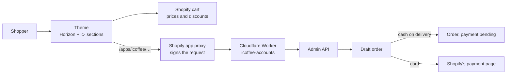

# `icoffee`

<Badge tone="client">Client</Badge> <Badge tone="building">Pre-launch</Badge>

**Client project.** The online store of **ICOFFEE Egypt**, a coffee brand
selling in cans and tins since 2018. ICOFFEE is a client, not a Group brand,
and its store runs on **Shopify**, which the client already used
([ADR-016](/architecture/adrs#adr-016--the-icoffee-store-stays-on-shopify)).

Private · one Shopify theme, one small app, one folder of scripts · not part of
the monorepo · npm · **the new design is built and unpublished**: the store's
previous theme is still what customers see

<Stats>
  <Stat value="41" label="sections" hint="every one prefixed ic-" />
  <Stat value="en · ar" label="locales" hint="English at the root, Arabic under /ar" />
  <Stat value="16" label="products" hint="27 sizes, as in the client's catalog" />
  <Stat value="3" label="parts" hint="theme · app · tools" />
</Stats>

## What it is

Three things in one repository, because none of them is useful without the
others:

- **`theme/`: the new storefront.** Shopify's own Horizon theme, version
  4.2.0, with ICOFFEE's design built on top as sections and snippets that all
  start with `ic-`. Horizon's files are left alone, so the base theme can still
  be updated.
- **`icoffee-accounts/`: the app.** A Cloudflare Worker that answers the
  store's app proxy. The theme calls it for the customer's profile, addresses,
  wishlist and order history, and for the checkout. It has no database: it
  reads and writes the store through the Admin API.
- **`tools/`: the scripts.** Node scripts that update the store from the
  client's catalog, drive the preview theme in a browser and report, and build
  the videos and reports sent to the client.

The store itself — products, prices, orders, customers — lives in Shopify, not
in git. *Why that matters:* a clone of this repository is not a copy of the
shop. It is everything the department built around it.

**How it got into git.** The work started on 4 October 2026 in a folder that
was not a repository, with hand-made snapshots before each change. On
11 October 2026 it was imported here as one commit. Until then the theme
existed on Shopify and on one laptop, and the app's source on that laptop
only.

## How it fits together



**The checkout is the unusual part.** The store's Shopify plan does not allow
a custom checkout, so the theme collects the delivery details on its own pages
and the app prices and places the order through a **draft order**. Cash on
delivery completes the draft as an order with payment pending; card payment
sends the shopper to Shopify's hosted payment page. Every price, discount and
shipping rate still comes from Shopify. If the app cannot answer, the page
hands over to Shopify's standard checkout, so ordering never breaks.

## Stack

| | |
| --- | --- |
| Platform | Shopify, on the client's own store and plan |
| Theme | Horizon 4.2.0 + `ic-` sections and snippets. Liquid, plain JavaScript, CSS inside each section's `` block. No build step |
| App | Cloudflare Worker (`nodejs_compat`), Shopify Admin GraphQL, client credentials grant. No database, no framework |
| Tools | Node scripts on Playwright (browser checks, videos, PDFs) and sharp (images), plus the Shopify CLI for the Admin API |
| Languages | English at the root, Arabic under `/ar`, both in the theme's locale files under one `ic` key |
| Package manager | **npm**, at the root and in `icoffee-accounts/` |
| CI, tests | None. The scripts in `tools/` are the checks, and they are run by hand |

## Running it

```bash
git clone git@github.com:Adawy-Group/icoffee.git
cd icoffee
npm install
npm run theme:dev        # = shopify theme dev against the unpublished theme
```

You need Node 20 or newer, the Shopify CLI installed globally, and a staff
account on the store: the CLI signs in through the browser, and nothing in the
repository holds a password or a token.

<Callout type="warning">
  **`shopify theme dev` uploads every file you save to the preview theme.** It
  is the real preview, not a sandbox. Do not create temporary files inside
  `theme/` while it runs: they are uploaded too.
</Callout>

## Layout

```
theme/              Horizon 4.2.0 + the ICOFFEE design
  sections/ic-*     one per block of a page: header, shop, product, cart, checkout…
  snippets/ic-*     shared pieces: product card, cart line, icons, brand tokens
  assets/ic-*.js    one script per area: shop, product, cart, checkout, bundle, account
  locales/          en.default.json, ar.json: every string, under "ic"
  templates/        which sections make up each page
icoffee-accounts/   the Worker: worker.js, api/proxy.js, api/checkout.js, lib/
tools/              store updates, browser checks, client videos and reports
brand/              logos, fonts, illustrations, the can renders the tools read
backup/             records of store changes, and a copy of the previous theme
```

## The rules to know before editing

The repository's `AGENTS.md` is the full list. These are the ones that cost
the most when missed:

- **Name the theme on every push.** `shopify theme push --theme <id>
  --nodelete --only <file>`. A push with no theme asks which one to use, and
  the published theme is on that list.
- **The store is live.** Products, prices, discounts and shipping rates are
  shared with the published theme. A store change made "for the new design"
  is a change customers see today. Every store script has `--check`, which
  only reads.
- **Nothing is erased.** Products are archived, photos are detached, and a
  record goes into `backup/`. Permanent deletion is the store owner's call.
- **All section CSS is global.** A class in one section's ``
  styles every section, so every class is prefixed and names are not reused.
- **Prices and totals come from Shopify**, never from theme arithmetic. The
  bundle builder previews a saving that Shopify itself applies as an automatic
  discount; the checkout shows the total the app got from a draft order.
- **Both languages, always.** A new string goes into both locale files under
  the same key, and the layout is checked in Arabic on a phone.
- **Shopify's app proxy replaces any 5xx answer with its own error page.**
  Errors the theme has to read are 4xx.

## Deploying

There is no pipeline. The three parts ship three ways:

| Part | How it ships |
| --- | --- |
| Theme | `shopify theme push` to the unpublished theme. The client reviews it through Shopify's preview link. Launch is publishing that theme in the Shopify admin |
| App | `npx wrangler deploy` from `icoffee-accounts/`. `shopify app deploy` only when the scopes or the proxy change, and then the store owner has to open the app once to approve them |
| Store data | A script in `tools/`, run by hand, `--check` first |

**What is still open before launch:** the client's domain has not moved to
Shopify, the store's policies are not filled in, and the bundle discounts are
deliberately not created yet, because Shopify would apply them on the
published theme too. The README lists the steps.

## What this repo is not

- **Not on the [floor](/architecture/tech-stack#what-a-client-project-is-required-to-run).**
  The floor is Next.js, TypeScript and Tailwind; a Shopify theme is Liquid.
  What carries over is the standards: bilingual with real RTL, accessible
  markup, every string in a locale file.
- **Not a pattern for Group stores.** The Group's own commerce stays on its
  own stack ([ADR-005](/architecture/adrs)). ICOFFEE is on Shopify because the
  client was, and the record of that decision says what it costs.
