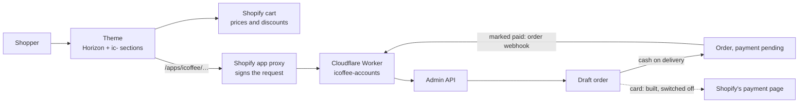

# `icoffee`

<Badge tone="client">Client</Badge> <Badge tone="live">Live</Badge>

**Client project.** The online store of **ICOFFEE Egypt**, a coffee brand
selling in cans and tins since 2018. ICOFFEE is a client, not a Group brand,
and its store runs on **Shopify**, which the client already used
([ADR-016](/architecture/adrs#adr-016--the-icoffee-store-stays-on-shopify)).

Private · one Shopify theme, one small app, one folder of scripts · not part of
the monorepo · npm · **live since 20 October 2026**: the new design is the
published theme and `icoffeeegypt.com` is the store's primary domain, so every
theme push reaches customers at once

<Stats>
  <Stat value="41" label="sections" hint="every one prefixed ic-" />
  <Stat value="en · ar" label="locales" hint="English at the root, Arabic under /ar" />
  <Stat value="16" label="products" hint="27 sizes, as in the client's catalog" />
  <Stat value="3" label="parts" hint="theme · app · tools" />
</Stats>

## What it is

Three things in one repository, because none of them is useful without the
others:

- **`theme/`: the storefront.** Shopify's own Horizon theme, version 4.2.0,
  with ICOFFEE's design built on top as sections and snippets that all start
  with `ic-`. Horizon's files are left alone, so the base theme can still be
  updated.
- **`icoffee-accounts/`: the app.** A Cloudflare Worker that answers the
  store's app proxy. The theme calls it for the customer's profile, addresses,
  wishlist, order history and points, and for the checkout; Shopify's order
  webhooks call it to keep each order's points in step. It has no database:
  it reads and writes the store through the Admin API.
- **`tools/`: the scripts.** Node scripts that update the store from the
  client's catalog, set the bundle discounts, the points rules and the policy
  pages, drive the theme in a browser and report, and build the videos and
  reports sent to the client.

The store itself — products, prices, orders, customers — lives in Shopify, not
in git. *Why that matters:* a clone of this repository is not a copy of the
shop. It is everything the department built around it.

**How it got into git.** The work started on 4 October 2026 in a folder that
was not a repository, with hand-made snapshots before each change. On
11 October 2026 it was imported here as one commit. Until then the theme
existed on Shopify and on one laptop, and the app's source on that laptop
only.

## How it fits together



**The checkout is the unusual part.** The store is on Shopify Basic, which
does not allow a custom checkout, so the theme collects the delivery details
on its own pages and the app prices and places the order through a **draft
order**. Cash on delivery completes the draft as an order with payment
pending. Card payment is built (it sends the shopper to Shopify's hosted
payment page) but **switched off**, because the store has no card provider
yet: Theme settings > "Offer card payment" stays off until one is chosen.
Every price, discount and shipping rate still comes from Shopify. If the app
cannot answer, the page hands over to Shopify's standard checkout, so ordering
never breaks.

**A draft order has no language of its own.** Shopify writes an order's
emails in the customer's saved language, and a customer the checkout created
had none, so an order placed in Arabic was confirmed in English. The checkout
now saves the shopper's checkout language on the customer before it makes the
draft; a failed update never blocks the order.

The ICOFFEE checkout takes Egyptian governorates only: there is no
international shipping for now (the lead's call, 2026-10-18).

## ICOFFEE points

The store's loyalty programme is **our own build in the ICOFFEE Accounts
app**, not an app from the App Store. *Why:* the CEO asked for one on
2026-10-20, and building it matched the design and carried no monthly fee,
where Gameball would have done neither.

- **Earning:** 1 point per 1 EGP of coffee (shipping not counted), once the
  order is **paid**, plus 100 points for signing up. Points expire 12 months
  after the customer's last order. A cancelled or refunded order loses its
  points again. Only orders from the ICOFFEE checkout earn by themselves; a
  WhatsApp order earns when the team tags it `Points` before marking it paid.
- **Cash-on-delivery orders earn only once the team marks them paid** in the
  admin. *Why:* a refused delivery must earn nothing. The flip side is that a
  COD order nobody marks paid earns nobody anything, so the team has to do it
  when the courier collects.
- **Using:** in the cart a signed-in customer picks how many points to spend,
  and the app makes a **one-time discount code** for that customer only
  (`ICP-…`, usage limit 1). *Why a code and not store credit:* store credit
  does not work on draft orders, and every ICOFFEE order is a draft; a Shopify
  Function would need Shopify Plus. Removing the code, or leaving it unused
  for 7 days, gives the points back. Points are not used together with the
  bundle discounts.
- **The live rate is 1000 points = 25 EGP**, set by the client on
  2026-10-21 (the programme launched at our proposed 500). The other rules are
  still our proposal, which the lead approved unchanged.
- **The rules are data, not code.** They live in the shop metafield
  `icoffee.loyalty_rules`, changed with `tools/loyalty-setup.js --set
  <rule>=<value>`; the theme and the app follow within a minute and points
  already earned are kept. *Why:* a rate change then needs no theme push and
  no deploy. With no rules metafield the programme is off and the theme shows
  nothing.
- **Each customer's ledger** is the metafield `icoffee.loyalty` (plus the
  plain balance `icoffee.points`, which the team sees on the customer page).
  Every line has a fixed id and an order *sets* its line to what it is worth
  now, so a repeated or late webhook never counts twice. The logic is
  `icoffee-accounts/lib/loyalty.js`, with tests.

## Stack

| | |
| --- | --- |
| Platform | Shopify Basic, on the client's own store |
| Theme | Horizon 4.2.0 + `ic-` sections and snippets. Liquid, plain JavaScript, CSS inside each section's `` block. No build step |
| App | Cloudflare Worker (`nodejs_compat`), Shopify Admin GraphQL, client credentials grant, HMAC-checked order webhooks. No database, no framework |
| Tools | Node scripts on Playwright (browser checks, videos, PDFs) and sharp (images), plus the Shopify CLI for the Admin API |
| Languages | English at the root, Arabic under `/ar`, both in the theme's locale files under one `ic` key |
| Runtime, package manager | Node **24** (`engines.node` `24.x`), **npm** at the root and in `icoffee-accounts/` |
| CI, tests | No workflows. `npm test` in `icoffee-accounts/` runs `node --test` suites for the points ledger and the checkout against a fake store; the scripts in `tools/` are the other checks, run by hand. Dependabot opens monthly, grouped npm PRs for both folders |

## Running it

```bash
git clone git@github.com:Adawy-Group/icoffee.git
cd icoffee
npm install
npm run theme:dev        # = shopify theme dev, on your own hidden development theme
```

You need Node 24, the Shopify CLI installed globally, and a staff account on
the store: the CLI signs in through the browser, and nothing in the repository
holds a password or a token.

<Callout type="error">
  **Never point `theme:dev` at the live theme.** `shopify theme dev` uploads
  every file you save to the theme it serves. Run without `--theme` it serves a
  hidden development theme of your own; with `--theme` and the live theme's id every save
  reaches customers at once. Do not create temporary files inside `theme/`
  while it runs either: they are uploaded too.
</Callout>

## Layout

```
theme/              Horizon 4.2.0 + the ICOFFEE design
  sections/ic-*     one per block of a page: header, shop, product, cart, checkout, policies…
  snippets/ic-*     shared pieces: product card, cart line, points card, icons, brand tokens
  assets/ic-*.js    one script per area: shop, product, cart, checkout, bundle, account, loyalty
  locales/          en.default.json, ar.json: every string, under "ic"
  templates/        which sections make up each page
icoffee-accounts/   the Worker: worker.js; api/proxy.js, checkout.js, webhooks.js;
                    lib/loyalty.js, shopify.js, input.js; test/
tools/              store updates, points and policy setup, browser checks, client videos and reports
brand/              logos, fonts, illustrations, the can renders the tools read
backup/             records of store changes, and copies of the old themes
```

## The rules to know before editing

The repository's `AGENTS.md` is the full list. These are the ones that cost
the most when missed:

- **Every theme push is live, so name the theme.** `shopify theme push --theme
  <live theme id> --nodelete --only <file>` (the id is in the repo's README;
  this public handbook does not carry it), after trying the change in
  `theme:dev`. A push with no theme asks which one to use, and the published
  theme is on that list.
- **The store is live.** Products, prices, discounts, shipping rates and pages
  are what customers see today. Every store script has `--check`, which only
  reads.
- **Nothing is erased.** Products are archived, photos are detached, and a
  record goes into `backup/`. Permanent deletion is the store owner's call.
- **All section CSS is global.** A class in one section's ``
  styles every section, so every class is prefixed and names are not reused.
- **Prices and totals come from Shopify**, never from theme arithmetic. The
  bundle builder previews a saving that Shopify itself applies as an automatic
  discount (any 4 coffees 5% off, any 8 coffees 10%, the client's tiers); the
  checkout shows the total the app got from a draft order. *That is why a
  bundle change is two edits that must match:* Theme settings > ICOFFEE
  bundles, and the two discounts in the Shopify admin.
- **Never edit a customer's points history by hand.** Its lines are what the
  app reconciles against; a correction goes through `tools/loyalty-adjust.js`,
  which writes the same way the app does.
- **Never invent a legal detail.** The Privacy Policy and Terms are the
  client's own words; a detail they left blank is a theme setting, and a
  sentence missing its detail stays hidden.
- **Both languages, always.** A new string goes into both locale files under
  the same key, and the layout is checked in Arabic on a phone.
- **Shopify's app proxy replaces any 5xx answer with its own error page.**
  Errors the theme has to read are 4xx.

## Deploying

There is no pipeline. The three parts ship three ways:

| Part | How it ships |
| --- | --- |
| Theme | `shopify theme push` to the live theme, named by its id every time, with `--nodelete --only`. Try it in `theme:dev` first |
| App | `npx wrangler@4 deploy` from `icoffee-accounts/`. `shopify app deploy` only when `shopify.app.toml` changes (scopes, proxy, webhooks), and then a staff member has to approve the new access; until then the affected routes answer `403 not_ready` and the theme falls back |
| Store data | A script in `tools/`, run by hand, `--check` first |

**Still open after launch** (the README keeps the list):

- **The email DNS records.** The move to `icoffeeegypt.com` lost the email
  records (SPF, DKIM, DMARC), Shopify's sender-email CNAMEs and the mail
  shortcuts, and they are not back yet: ICOFFEE's Cloudflare is held by
  someone outside the department, who has to add them. Until then order emails
  come from a Shopify address rather than the store's own.
- **No card provider.** Card payment stays switched off until the client
  chooses one.
- **The team must mark cash-on-delivery orders paid**, or nobody earns points.
- The Privacy and Terms pages' missing legal details and the store's own
  policies in Shopify, real stock numbers for the 125 GM sizes, and the owner
  removing the old themes (they are backed up in `backup/`).

## What this repo is not

- **Not on the [floor](/architecture/tech-stack#what-a-client-project-is-required-to-run).**
  The floor is Next.js, TypeScript and Tailwind; a Shopify theme is Liquid.
  What carries over is the standards: bilingual with real RTL, accessible
  markup, every string in a locale file.
- **Not a pattern for Group stores.** The Group's own commerce stays on its
  own stack ([ADR-005](/architecture/adrs)). ICOFFEE is on Shopify because the
  client was, and the record of that decision says what it costs.
